<p align="center">
  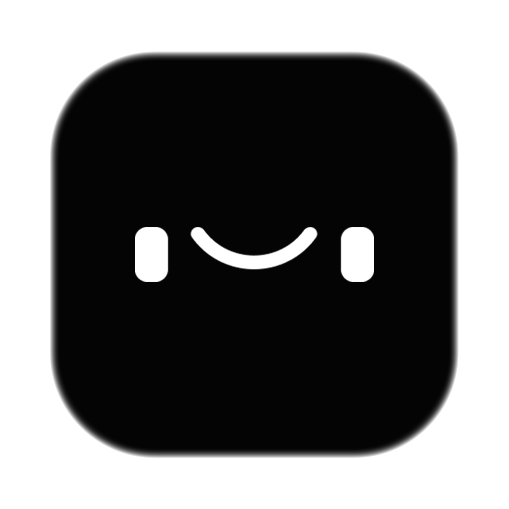
</p>

<h1 align="center">TAB</h1>

<p align="center">
  <b>Take A Break.</b><br>
  A tiny menu bar buddy for your Mac that keeps you hydrated, moving and rested.
</p>

<p align="center">
  
  
  
  
</p>

<p align="center">
  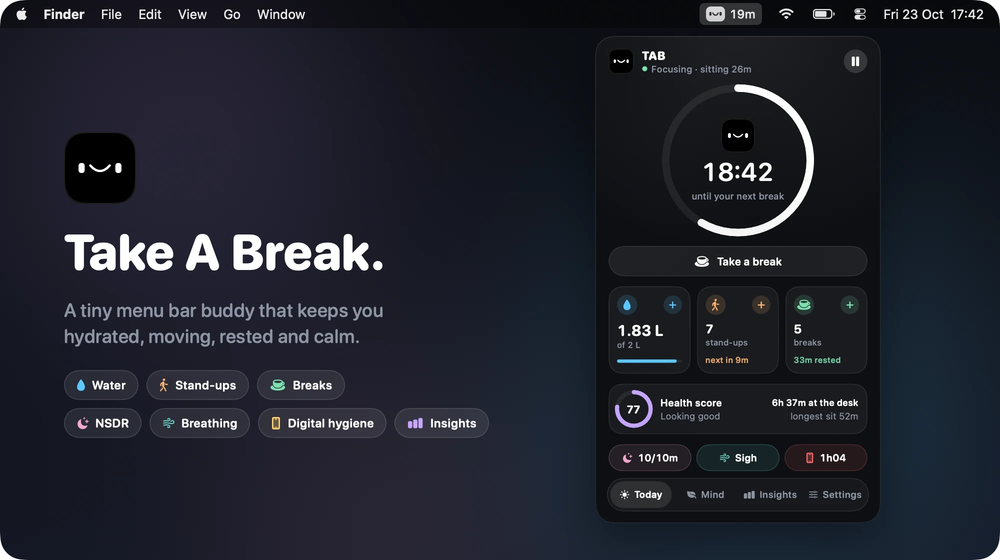
</p>

---

When you're deep in work, hours just disappear. You forget to drink, you forget to move, and suddenly your back hurts and it's dark outside.

TAB is a little face that lives in your menu bar. It counts down to your next break, reminds you to drink water and to get up from your chair, and quietly keeps track of how you actually work. Over weeks, months and years you can see whether your habits are getting healthier.

No account. No cloud. No dock icon. Just a friendly face next to your clock.

## Features

|  |  |
| --- | --- |
| 🔒 **Two break styles** | Pick **Lock Screen** if you need to be forced away from the desk, or **Gentle Nudge** for a friendly reminder you can start, snooze or skip. |
| 💧 **Water tracking** | Log a glass with one click, right-click for other sizes, set a daily goal in ml or oz and get reminders to sip. |
| ☕ **Break tracking** | Hit *Take a break* when you leave and *I'm back* when you return. TAB records every break, how long it was and whether you skipped it. |
| 🧍 **Stand up & stretch** | Reminders to get off the chair, with an interval based on research for your age group and a new stretch idea every time. |
| 📊 **Insights** | Day, week, month and year views of your desk time, water, breaks and stand-ups, plus a daily health score and trends. |
| 🧠 **Smart tracking** | Notices when you walk away from the Mac and counts it as a break. Knows when you're watching a video or on a call and won't think you left. |
| ⏸️ **Pause** | Pause reminders for 30 minutes, 1 hour, 2 hours or until tomorrow. |
| 🚀 **Starts with your Mac** | Launches at login by default, so you never have to think about it. |
| 📁 **Your data** | Export everything as CSV whenever you like. Erase it with one click. |

## A quick look

<table>
  <tr>
    <td align="center"><b>Today</b></td>
    <td align="center"><b>Insights</b></td>
    <td align="center"><b>Settings</b></td>
  </tr>
  <tr>
    <td valign="top">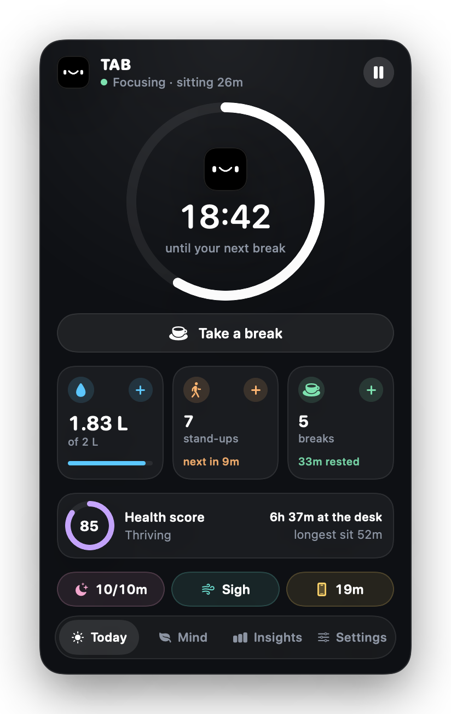</td>
    <td valign="top">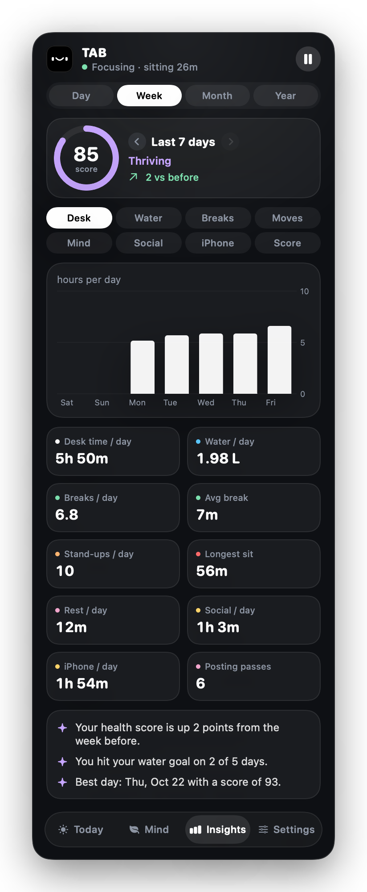</td>
    <td valign="top">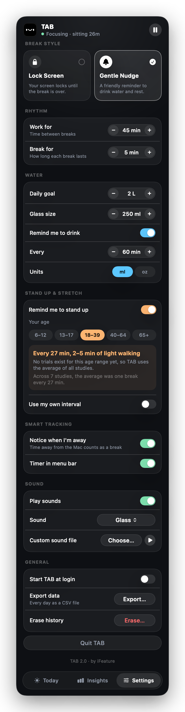</td>
  </tr>
</table>

The **Today** tab shows how long until your next break, how much you drank, how often you stood up and how many breaks you took. One click on a **+** logs it. The health score at the bottom sums up your day.

<table>
  <tr>
    <td align="center"><b>When it's time</b></td>
    <td align="center"><b>During a break</b></td>
  </tr>
  <tr>
    <td valign="top">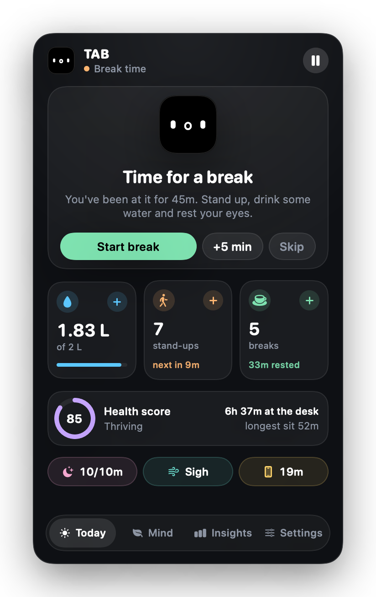</td>
    <td valign="top">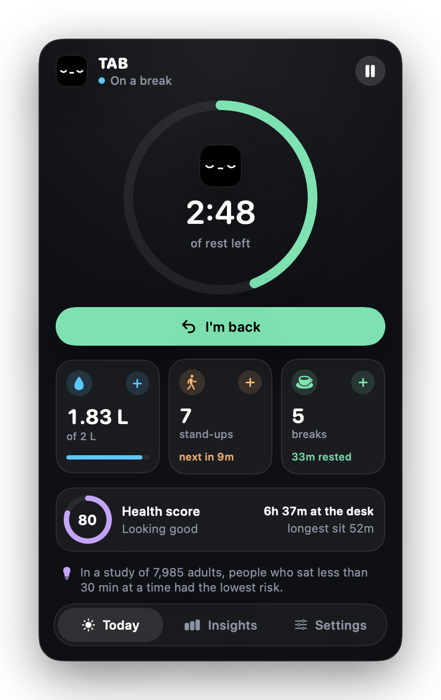</td>
  </tr>
</table>

## Two ways to take a break

### Lock Screen

For the people who always click "Skip". When the timer runs out, TAB covers every screen, pauses the keyboard and shows you a stretch to do. You get a 30 second warning first so you can save your work. When the break is over, click **I'm back** and you're good to go.

There's an emergency exit if you really need it: hold the skip button for 3 seconds. It gets counted as a skipped break though 😉

<p align="center">
  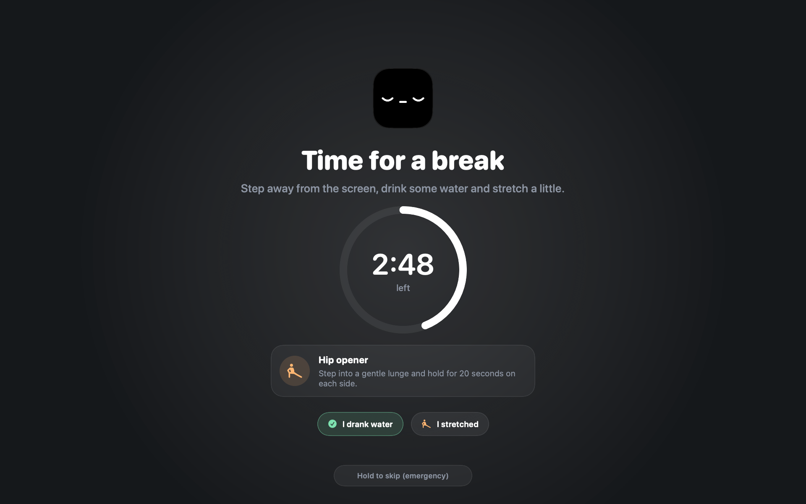
  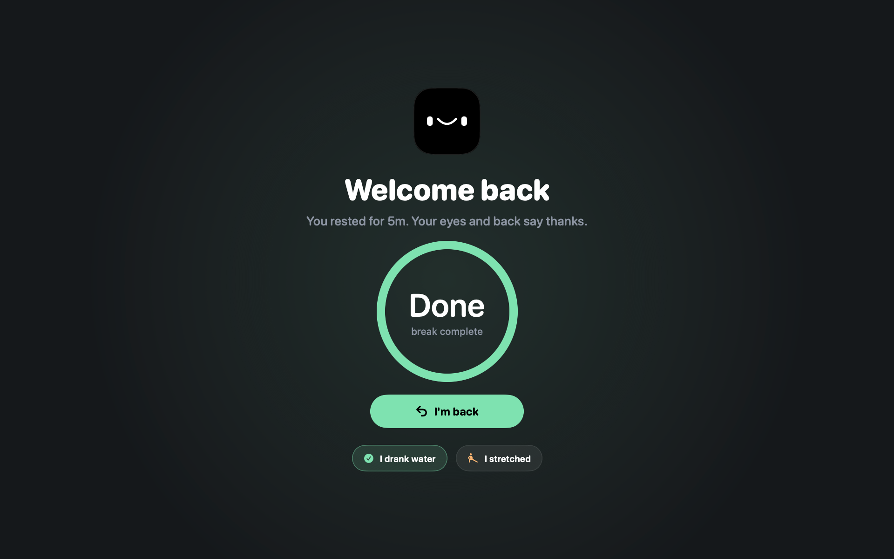
</p>

### Gentle Nudge

A small banner slides in under the menu bar. Start the break, give yourself 5 more minutes, or skip it. The same banners remind you to drink water and to stand up.

<table>
  <tr>
    <td>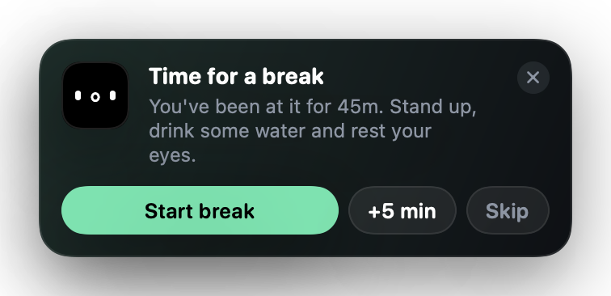</td>
    <td>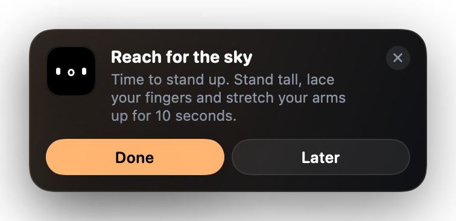</td>
  </tr>
  <tr>
    <td>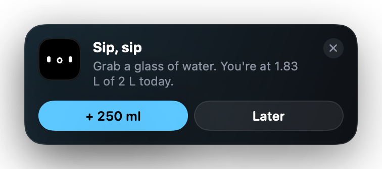</td>
    <td>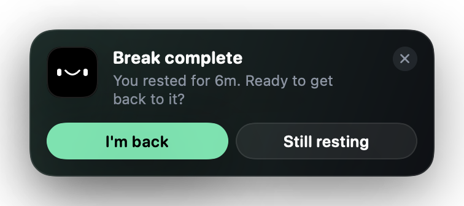</td>
  </tr>
</table>

When you come back to your Mac during a break, TAB says hi and asks if you're back, so the break gets logged with its real length.

## Your health over time

Switch between **Day**, **Week**, **Month** and **Year**, flip back through older periods with the arrows and hover over any bar to see the exact number. TAB also writes a few notes for you, like how many days you hit your water goal or when you sat way too long.

<table>
  <tr>
    <td align="center"><b>Day</b></td>
    <td align="center"><b>Month</b></td>
    <td align="center"><b>Year</b></td>
  </tr>
  <tr>
    <td valign="top">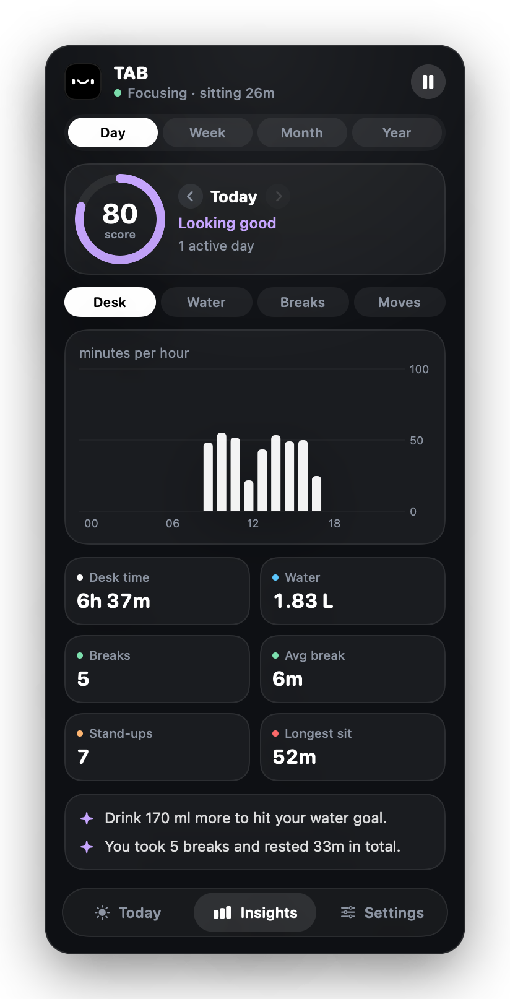</td>
    <td valign="top">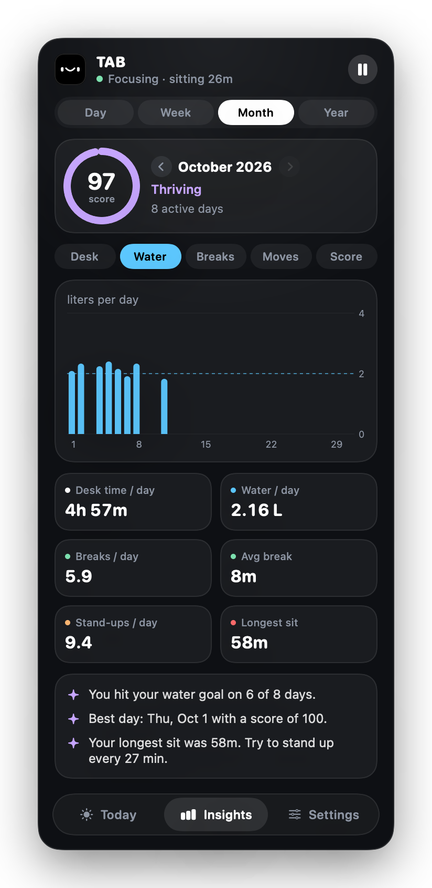</td>
    <td valign="top">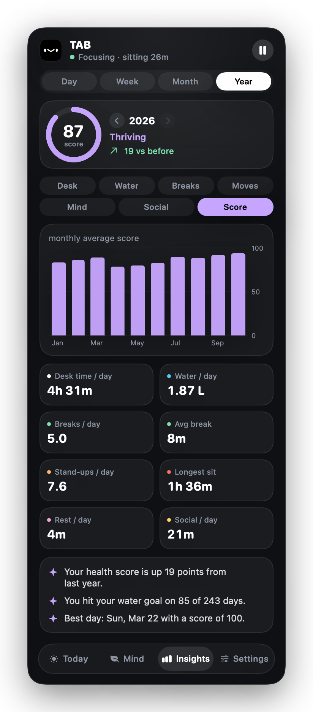</td>
  </tr>
</table>

### The health score

Every day gets a score from 0 to 100, built from three things:

| Part | Weight | What counts |
| --- | --- | --- |
| 💧 Hydration | 35% | How close you got to your daily water goal |
| ☕ Breaks | 35% | Breaks taken compared to the breaks you should have taken. Skipping and very long sitting stretches cost points. |
| 🧍 Movement | 30% | Stand-ups and breaks compared to how often your age group should get up |

85 and up is *Thriving*, 70 and up is *Looking good*.

## How often should you stand up?

Before building the stand-up reminder, we looked at what the research says. Most studies land on **getting up every 20 to 30 minutes** and **moving for 2 to 5 minutes**. Light walking works better than just standing.

TAB picks the interval from your age group. You can always set your own.

| Age | Stand up every | Move for | Based on |
| --- | --- | --- | --- |
| 6–12 | 30 min | 3 min of brisk walking | Belcher et al. 2015 |
| 13–17 | 25 min | 2–5 min | Penning et al. 2017 (20 min), kids' guidelines (30 min) |
| 18–39 | 27 min | 2–5 min of light walking | Average of all studies below (no trials in this age range yet) |
| 40–64 | 27 min | 2–5 min of light walking | Dunstan 2012, Duran 2023, Diaz 2017 |
| 65+ | 30 min | 5 min of light walking | Yates 2020, Diaz 2017 |

Across all seven studies that name an interval, the average is **27 minutes**.

<details>
<summary><b>Sources</b></summary>
<br>

| Study | Who | Finding |
| --- | --- | --- |
| [Dunstan et al. 2012, *Diabetes Care*](https://doi.org/10.2337/dc11-1931) | Adults 45–65 | 2 min of walking every 20 min lowered blood sugar and insulin after a meal. |
| [Duran, Diaz et al. 2023, *Med Sci Sports Exerc*](https://doi.org/10.1249/MSS.0000000000003109) | Middle-aged and older adults | 5 min of walking every 30 min was the only schedule that lowered blood sugar. All schedules lowered blood pressure. |
| [Diaz et al. 2017, *Annals of Internal Medicine*](https://pubmed.ncbi.nlm.nih.gov/28892811/) | 7,985 adults 45+ | People who mostly sat for less than 30 min at a time had the lowest risk of death. |
| [Hedge, Cornell University Ergonomics](https://ergo.human.cornell.edu/CUESitStandPrograms.html) | Office workers | In every 30 min: sit 20, stand 8, move 2. |
| [Belcher et al. 2015, *J Clin Endocrinol Metab*](https://doi.org/10.1210/jc.2015-2803) | Children 7–11 | 3 min of walking every 30 min cut insulin by 32%. |
| [Yates et al. 2020, *J Gerontol A*](https://doi.org/10.1093/gerona/gly252) | Adults 65–79 | 5 min of light walking every 30 min helped. Standing alone did not. |
| [Penning et al. 2017, *BMC Public Health*](https://pmc.ncbi.nlm.nih.gov/articles/PMC5558656/) | Teens 13–14 | No sitting bout over 20 min improved a blood-fat marker. |
| [Buckley et al. 2015, *Br J Sports Med*](https://bjsm.bmj.com/content/49/21/1357) | Desk workers | Build up to 2 h, then 4 h of standing or light activity per workday. |
| [WHO 2020 guidelines](https://www.who.int/publications/i/item/9789240015128) | All ages | Limit sitting time and replace it with activity of any intensity. |

</details>

> TAB is a reminder app, not a medical device. If you have health concerns, talk to your doctor.

## The little face

The menu bar icon changes with what's going on, so you can tell where you are at a glance.

<p align="center">
  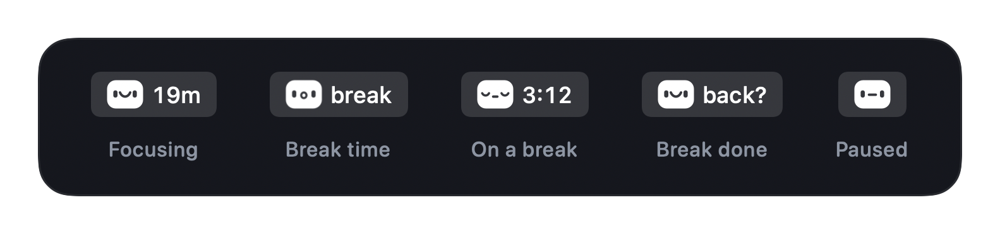
</p>

Left click opens TAB. Right click gives you a quick menu to start a break, log water, log a stand-up or pause.

## Install

You need macOS 13 Ventura or newer and Xcode (or the Xcode Command Line Tools).

```bash
git clone https://github.com/iFeaturemusic/TAB.git
cd TAB
./build.sh install
```

`./build.sh` builds a universal app (Apple silicon and Intel) into `build/TAB.app`. Adding `install` copies it to `/Applications` and starts it.

### Lock Screen permission

The Lock Screen style can also pause the keyboard during a break. For that, macOS asks you to allow TAB under **System Settings › Privacy & Security › Accessibility**. Without it, the lock screen still works, the keyboard just isn't paused.

## Privacy

Everything stays on your Mac. TAB has no account, no analytics and never connects to the internet. Your history lives in a single file:

```
~/Library/Application Support/TAB/history.json
```

You can export it as CSV from the settings or erase it at any time.

## Project layout

```
Sources/
  Engine.swift          timers, breaks, reminders and away detection
  HistoryStore.swift    saves every day to history.json
  Analytics.swift       day, week, month and year insights
  Health.swift          stand-up research, tips and stretches
  StatusBar.swift       menu bar face and the panel
  Banner.swift          reminder banners
  LockScreen.swift      full screen break
  TodayView.swift       the Today tab
  InsightsView.swift    the Insights tab
  SettingsView.swift    the Settings tab
Resources/              Info.plist and app icon
build.sh                build, sign and install
```

---

<p align="center">
  Made by <b>iFeature</b><br>
  <sub>© 2026 iFeature</sub>
</p>
