<p align="center">
  
</p>

<h1 align="center">TAB</h1>

<p align="center">
  <b>Take A Break.</b><br>
  A tiny menu bar buddy for your Mac that keeps you hydrated, moving, rested and calm.
</p>

<p align="center">
  
  
  
  
  
</p>

<p align="center">
  
</p>

---

When you're deep in work, hours just disappear. You forget to drink, you forget to move, and suddenly your back hurts and it's dark outside.

TAB is a little face that lives in your menu bar. It counts down to your next break, reminds you to drink water and to get up from your chair, guides you through a daily deep rest, and keeps an eye on how much time disappears into social media. Over weeks, months and years you can see whether your habits are getting healthier.

And when you're focusing, TAB on your iPhone locks the apps that pull you away, so the phone can't sneak in either.

No account. No server. No dock icon. Just a friendly face next to your clock.

## Features

|  |  |
| --- | --- |
| 🔒 **Two break styles** | Pick **Lock Screen** if you need to be forced away from the desk, or **Gentle Nudge** for a friendly reminder you can start, snooze or skip. |
| 💧 **Water tracking** | Log a glass with one click, right-click for other sizes, set a daily goal in ml or oz and get reminders to sip. |
| ☕ **Break tracking** | Hit *Take a break* when you leave and *I'm back* when you return. TAB records every break, how long it was and whether you skipped it. |
| 🧍 **Stand up & stretch** | Reminders to get off the chair, with an interval based on research for your age group and a new stretch idea every time. |
| 🌙 **NSDR & meditation** | A daily 5, 10 or 20 minute deep rest with a calm voice guiding you through it. Daily reminder and streaks included. |
| 🌬️ **Physiological sigh** | A guided breathing reset: two breaths in through the nose, one long breath out. 1 minute when you need it, 5 minutes as a daily practice. |
| 📱 **Digital hygiene** | Counts your time in social media apps and websites, nudges you when you've been scrolling too long and keeps notifications for your breaks. |
| 📊 **Insights** | Day, week, month and year views of desk time, water, breaks, stand-ups, rest and social media, plus a daily health score and trends. |
| 🧠 **Smart tracking** | Notices when you walk away from the Mac and counts it as a break. Knows when you're watching a video or on a call and won't think you left. |
| ⏸️ **Pause** | Pause reminders for 30 minutes, 1 hour, 2 hours or until tomorrow. |
| 🚀 **Starts with your Mac** | Launches at login by default, so you never have to think about it. |
| 📲 **iPhone companion** | While your Mac is in focus mode, your iPhone locks almost everything. Unlock your social apps for a few minutes when you need to post. Your phone time shows up in TAB on your Mac. |
| ⚡ **Automations** | Start a break, a breathing reset or NSDR from Shortcuts, Raycast or a Stream Deck with `takeabreak://` links. |
| 📁 **Your data** | Export everything as CSV whenever you like. Erase it with one click. |

## A quick look

<table>
  <tr>
    <td align="center"><b>Today</b></td>
    <td align="center"><b>Mind</b></td>
    <td align="center"><b>Insights</b></td>
    <td align="center"><b>Settings</b></td>
  </tr>
  <tr>
    <td valign="top"></td>
    <td valign="top">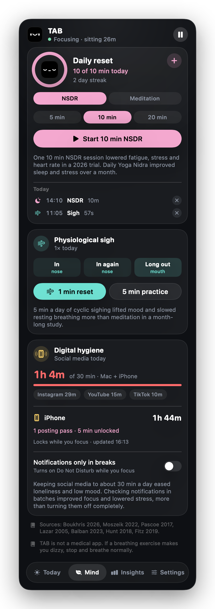</td>
    <td valign="top"></td>
    <td valign="top"></td>
  </tr>
</table>

The **Today** tab shows how long until your next break, how much you drank, how often you stood up and how many breaks you took. One click on a **+** logs it. The health score sums up your day, and the row below it starts your daily rest, a breathing reset, or shows your social media time.

<table>
  <tr>
    <td align="center"><b>When it's time</b></td>
    <td align="center"><b>During a break</b></td>
  </tr>
  <tr>
    <td valign="top"></td>
    <td valign="top"></td>
  </tr>
</table>

## Two ways to take a break

### Lock Screen

For the people who always click "Skip". When the timer runs out, TAB covers every screen, pauses the keyboard and shows you a stretch to do, or guides you through a physiological sigh right there. You get a 30 second warning first so you can save your work. When the break is over, click **I'm back** and you're good to go.

There's an emergency exit if you really need it: hold the skip button for 3 seconds. It gets counted as a skipped break though 😉

<p align="center">
  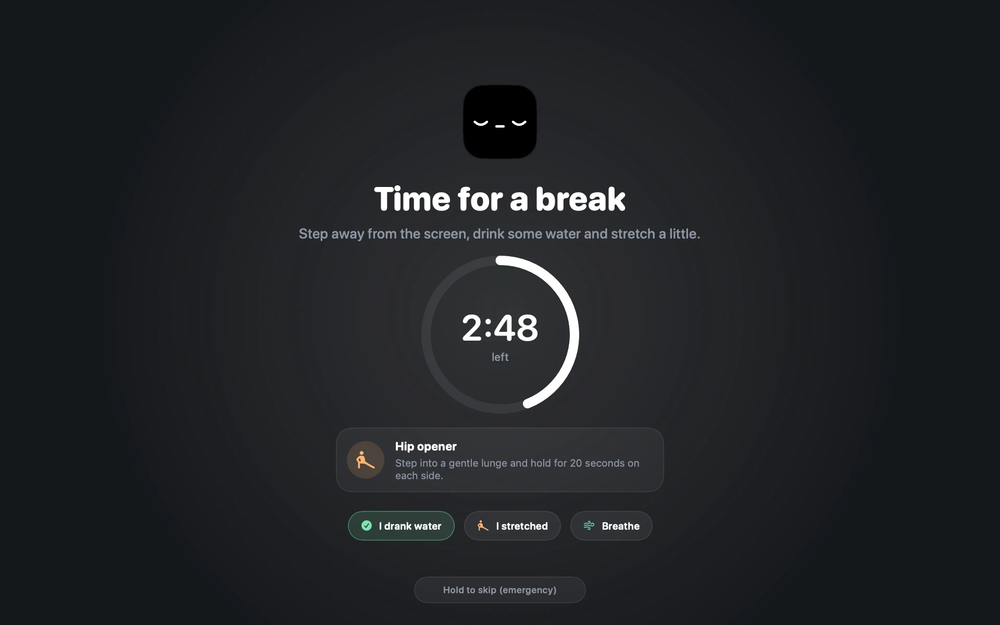
  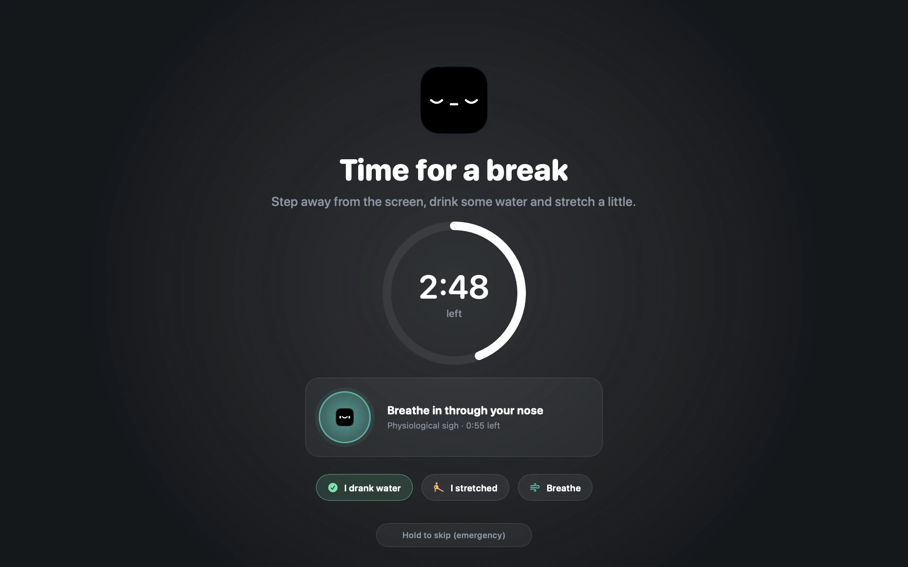
</p>

### Gentle Nudge

A small banner slides in under the menu bar. Start the break, give yourself 5 more minutes, or skip it. The same banners remind you to drink water and to stand up.

<table>
  <tr>
    <td></td>
    <td></td>
  </tr>
  <tr>
    <td></td>
    <td></td>
  </tr>
</table>

When you come back to your Mac during a break, TAB says hi and asks if you're back, so the break gets logged with its real length.

## Mind

Breaks keep your body going. The **Mind** tab is for your head.

### Daily reset: NSDR or meditation

NSDR (non-sleep deep rest) is a guided body scan you do lying down or leaning back with your eyes closed. Pick NSDR or a simple breath meditation, choose 5, 10 or 20 minutes and press start. A calm voice talks you through it, the screen goes dark, and a soft bell tells you when it's over. Your time counts as a break too.

TAB reminds you once a day at a time you choose (2 pm by default, right in the after-lunch dip) and only if you haven't done it yet. Do it every day and you build a streak.

Meditated on your own, in a class or with another app? Tap the **+** on the Daily reset card, pick what you did, how long and when it ended, and it counts for your goal, streak and score just like a session in TAB. Today's sessions are listed right below, so you can remove one if you made a mistake.

<table>
  <tr>
    <td valign="top">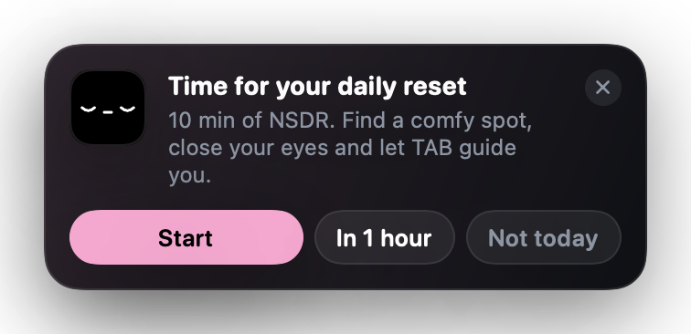</td>
    <td valign="top">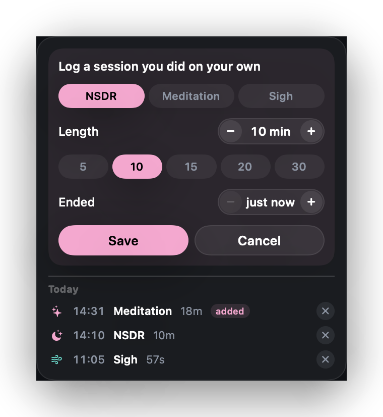</td>
  </tr>
</table>

<p align="center">
  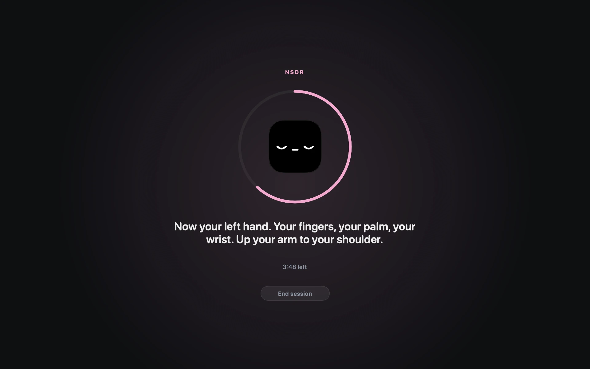
  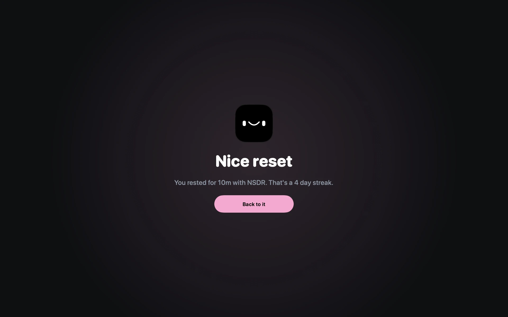
</p>

### Nervous system reset: the physiological sigh

Breathe in through the nose, sip in a little more air on top, then let it all out slowly through the mouth. The bubble grows and shrinks with you, so you can follow along with your eyes closed or open. Use the **1 minute reset** when you feel wound up, or the **5 minute practice** once a day. You can also start it from the lock screen during a break or from the right-click menu.

<p align="center">
  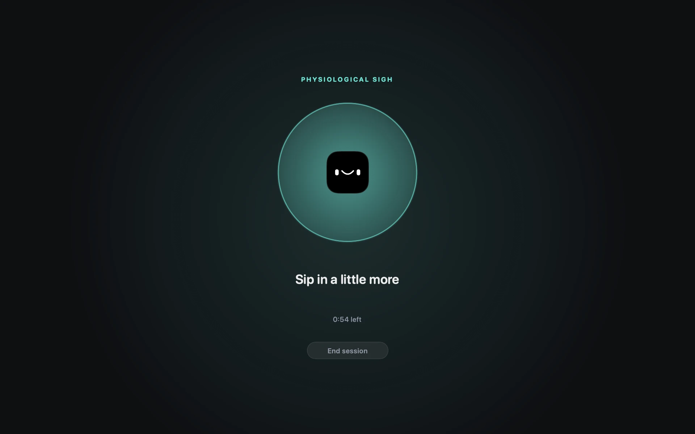
</p>

### Digital hygiene

TAB counts the time you spend in social media apps like Instagram, WhatsApp or Discord. You choose the apps, and you can add websites too (Safari, Chrome, Arc, Brave, Edge and Vivaldi). Set a daily limit, and if you get stuck scrolling for 5 minutes in a row while you should be working, the little face taps you on the shoulder.

**Notifications only in breaks.** Turn this on and TAB switches Do Not Disturb on while you focus and off again when you take a break, so messages arrive in batches instead of all day long. It uses two tiny shortcuts you create once in the Shortcuts app:

1. **TAB Focus On** with the action *Set Focus › Do Not Disturb › On*
2. **TAB Focus Off** with the action *Set Focus › Do Not Disturb › Off*

<table>
  <tr>
    <td>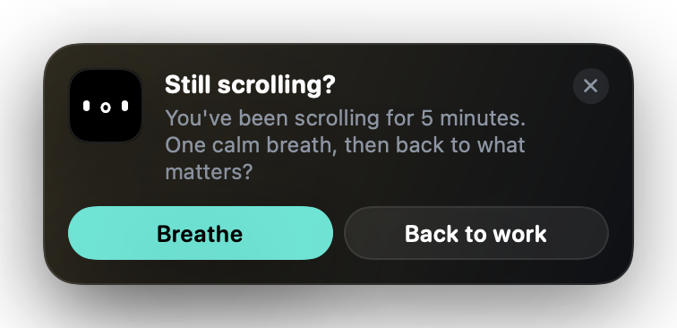</td>
    <td>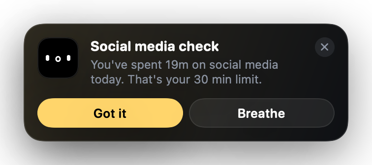</td>
  </tr>
</table>

### What the research says

We checked the science before building this, and kept only what holds up.

| Practice | What studies found | Sources |
| --- | --- | --- |
| 🌙 NSDR / Yoga Nidra | A single 10 minute NSDR session lowered sleepiness, fatigue and stress and slightly lowered heart rate. 11 minutes of Yoga Nidra a day for a month reduced stress and improved sleep. | [Boukhris 2026](https://doi.org/10.1111/aphw.70180), [Moszeik 2022](https://doi.org/10.1007/s12144-020-01042-2) |
| 🧘 Meditation | Meditation lowered cortisol, blood pressure and heart rate across 45 trials. Long-term meditators have a thicker prefrontal cortex, though an 8 week course did not change brain structure in the largest trial. | [Pascoe 2017](https://doi.org/10.1016/j.jpsychires.2017.08.004), [Lazar 2005](https://doi.org/10.1097/01.wnr.0000186598.66243.19), [Kral 2022](https://doi.org/10.1126/sciadv.abk3316) |
| 🌬️ Physiological sigh | 5 minutes of cyclic sighing a day for a month lifted mood and slowed resting breathing more than mindfulness meditation. | [Balban 2023](https://doi.org/10.1016/j.xcrm.2022.100895) |
| 📱 Social media | Limiting social media to about 10 minutes per platform (30 a day) for 3 weeks reduced loneliness and low mood. | [Hunt 2018](https://doi.org/10.1521/jscp.2018.37.10.751) |
| 🔕 Notifications | Notifications made people more inattentive. Checking them in batches a few times a day improved focus and mood and lowered stress, more than switching them off completely. | [Kushlev 2016](https://doi.org/10.1145/2858036.2858359), [Fitz 2019](https://doi.org/10.1016/j.chb.2019.07.016) |

## TAB for iPhone

<p align="center">
  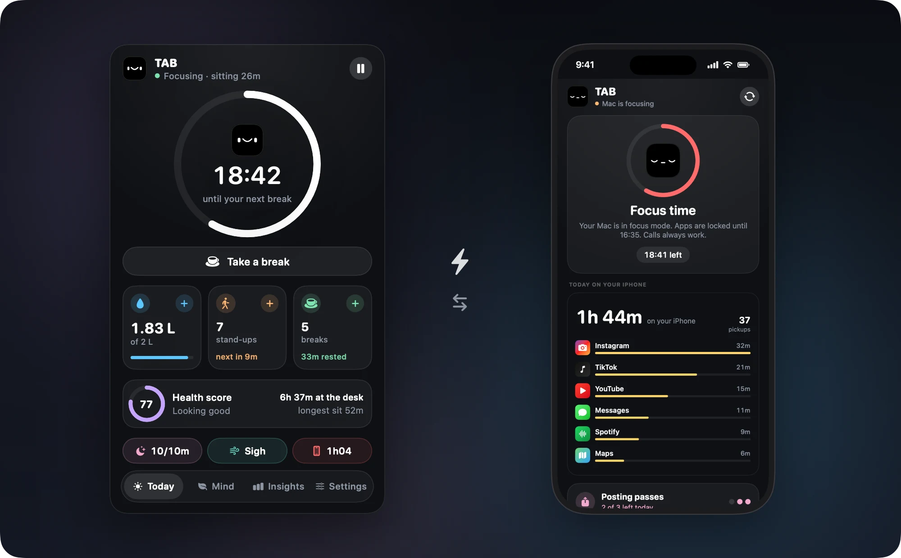
</p>

When a focus block starts on your Mac, your phone locks within a second or two. When you take a break, it opens again just as fast. Your Mac talks to your iPhone directly through Apple Push, so it works even when TAB on the phone is closed, and your phone time comes back to your Mac over your Wi-Fi. No iCloud, no server, no account. If your Mac goes to sleep in the middle of a block, the phone still unlocks on its own when the block would have ended.

- **Locks almost everything** while you focus. You choose the apps that always stay open, like Messages, Maps or music. Calls always work. Prefer a lighter version? Switch to *Social apps only*.
- **Posting passes.** Need to post a story? Tap **Post for 5 min** on the lock screen. Your social apps open for 5 minutes of use, then lock again by themselves. You get 3 passes a day, or as many as you set.
- **Phone time on your Mac.** Total time on the iPhone and the time in each social app go to TAB on your Mac, into the Mind tab, Insights and your health score. Your social media limit counts Mac and iPhone together.
- **Exact numbers on the phone.** The iPhone app shows today's screen time, pickups and top apps straight from Screen Time.

<table>
  <tr>
    <td align="center"><b>Focus time</b></td>
    <td align="center"><b>Locked app</b></td>
    <td align="center"><b>Settings</b></td>
  </tr>
  <tr>
    <td valign="top">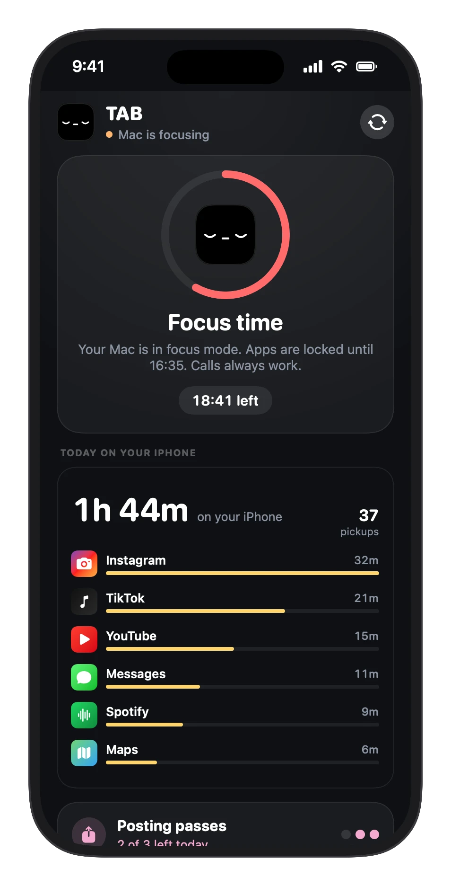</td>
    <td valign="top">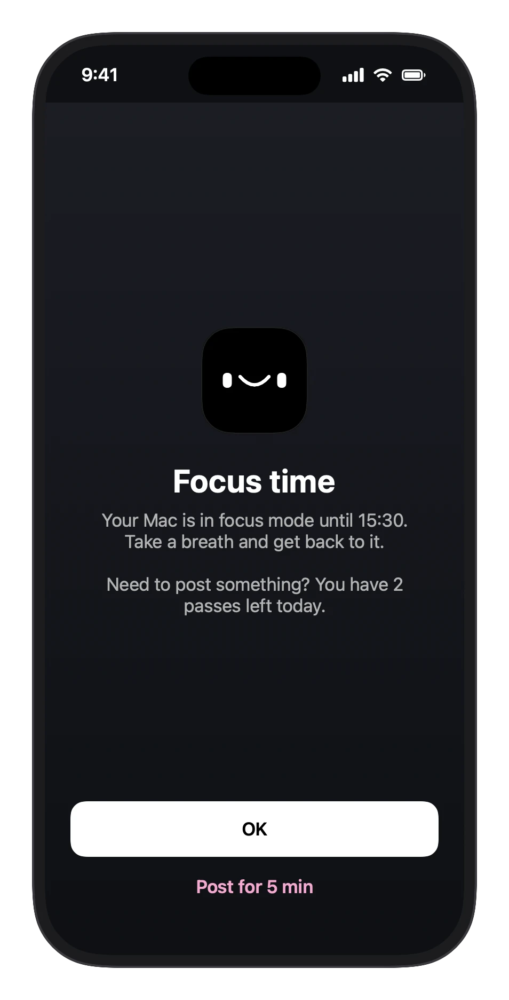</td>
    <td valign="top">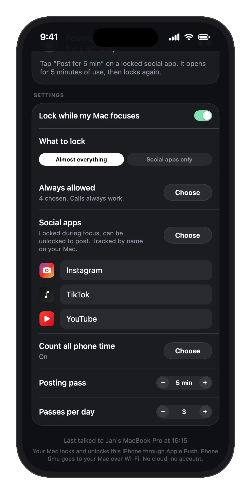</td>
  </tr>
</table>

**Good to know.** Every lock and unlock arrives as a quiet notification (no sound, no banner), because that's the only way iOS lets an app react instantly. Apple's Screen Time rules keep app names private, so you give your social apps a name once on the iPhone and TAB on your Mac uses those names. Phone time reaches the Mac in 5 minute steps, whenever both are on the same Wi-Fi. iOS can't tell posting from scrolling, which is why a pass is a short timer.

## Your health over time

Switch between **Day**, **Week**, **Month** and **Year**, flip back through older periods with the arrows and hover over any bar to see the exact number. Look at desk time, water, breaks, stand-ups, rest, social media or your score. TAB also writes a few notes for you, like how many days you hit your water goal or stayed under your social media limit.

<table>
  <tr>
    <td align="center"><b>Day</b></td>
    <td align="center"><b>Month</b></td>
    <td align="center"><b>Year</b></td>
  </tr>
  <tr>
    <td valign="top"></td>
    <td valign="top"></td>
    <td valign="top"></td>
  </tr>
</table>

### The health score

Every day gets a score from 0 to 100, built from four things:

| Part | Weight | What counts |
| --- | --- | --- |
| 💧 Hydration | 25% | How close you got to your daily water goal |
| ☕ Breaks | 25% | Breaks taken compared to the breaks you should have taken. Skipping and very long sitting stretches cost points. |
| 🧍 Movement | 25% | Stand-ups and breaks compared to how often your age group should get up |
| 🌙 Mind | 25% | Your daily reset, a breathing session, and staying under your social media limit |

If you'd rather leave Mind out, switch it off in the settings and the other three share the score again (35 / 35 / 30). 85 and up is *Thriving*, 70 and up is *Looking good*.

## How often should you stand up?

Before building the stand-up reminder, we looked at what the research says. Most studies land on **getting up every 20 to 30 minutes** and **moving for 2 to 5 minutes**. Light walking works better than just standing.

TAB picks the interval from your age group. You can always set your own.

| Age | Stand up every | Move for | Based on |
| --- | --- | --- | --- |
| 6–12 | 30 min | 3 min of brisk walking | Belcher et al. 2015 |
| 13–17 | 25 min | 2–5 min | Penning et al. 2017 (20 min), kids' guidelines (30 min) |
| 18–39 | 27 min | 2–5 min of light walking | Average of all studies below (no trials in this age range yet) |
| 40–64 | 27 min | 2–5 min of light walking | Dunstan 2012, Duran 2023, Diaz 2017 |
| 65+ | 30 min | 5 min of light walking | Yates 2020, Diaz 2017 |

Across all seven studies that name an interval, the average is **27 minutes**.

<details>
<summary><b>Sources</b></summary>
<br>

| Study | Who | Finding |
| --- | --- | --- |
| [Dunstan et al. 2012, *Diabetes Care*](https://doi.org/10.2337/dc11-1931) | Adults 45–65 | 2 min of walking every 20 min lowered blood sugar and insulin after a meal. |
| [Duran, Diaz et al. 2023, *Med Sci Sports Exerc*](https://doi.org/10.1249/MSS.0000000000003109) | Middle-aged and older adults | 5 min of walking every 30 min was the only schedule that lowered blood sugar. All schedules lowered blood pressure. |
| [Diaz et al. 2017, *Annals of Internal Medicine*](https://pubmed.ncbi.nlm.nih.gov/28892811/) | 7,985 adults 45+ | People who mostly sat for less than 30 min at a time had the lowest risk of death. |
| [Hedge, Cornell University Ergonomics](https://ergo.human.cornell.edu/CUESitStandPrograms.html) | Office workers | In every 30 min: sit 20, stand 8, move 2. |
| [Belcher et al. 2015, *J Clin Endocrinol Metab*](https://doi.org/10.1210/jc.2015-2803) | Children 7–11 | 3 min of walking every 30 min cut insulin by 32%. |
| [Yates et al. 2020, *J Gerontol A*](https://doi.org/10.1093/gerona/gly252) | Adults 65–79 | 5 min of light walking every 30 min helped. Standing alone did not. |
| [Penning et al. 2017, *BMC Public Health*](https://pmc.ncbi.nlm.nih.gov/articles/PMC5558656/) | Teens 13–14 | No sitting bout over 20 min improved a blood-fat marker. |
| [Buckley et al. 2015, *Br J Sports Med*](https://bjsm.bmj.com/content/49/21/1357) | Desk workers | Build up to 2 h, then 4 h of standing or light activity per workday. |
| [WHO 2020 guidelines](https://www.who.int/publications/i/item/9789240015128) | All ages | Limit sitting time and replace it with activity of any intensity. |

</details>

> TAB is a reminder app, not a medical device. If you have health concerns, talk to your doctor.

## The little face

The menu bar icon changes with what's going on, so you can tell where you are at a glance.

<p align="center">
  
</p>

Left click opens TAB. Right click gives you a quick menu to start a break, log water, log a stand-up, breathe, start your NSDR or pause.

## Automations

TAB understands `takeabreak://` links, so you can trigger it from the Shortcuts app, Raycast, Alfred, a Stream Deck or the Terminal:

| Link | What it does |
| --- | --- |
| `takeabreak://breathe` | 1 minute physiological sigh (`takeabreak://breathe/5` for 5 minutes) |
| `takeabreak://nsdr` | Start your NSDR (`takeabreak://nsdr/20` for 20 minutes) |
| `takeabreak://meditate` | Start a breath meditation |
| `takeabreak://log/meditation/18` | Log a session you did on your own (`nsdr`, `meditation` or `sigh`, then minutes) |
| `takeabreak://break` / `takeabreak://back` | Start or end a break |
| `takeabreak://water` | Log a glass of water (`takeabreak://water/500` for 500 ml) |
| `takeabreak://stand` | Log a stand-up |
| `takeabreak://pause/60` / `takeabreak://resume` | Pause reminders for 60 minutes, or resume |
| `takeabreak://end` | End the running breathing or rest session |

```bash
open takeabreak://breathe
```

## Install

You need macOS 13 Ventura or newer and Xcode (or the Xcode Command Line Tools).

```bash
git clone https://github.com/iFeaturemusic/TAB.git
cd TAB
./build.sh install
```

`./build.sh` builds a universal app (Apple silicon and Intel) into `build/TAB.app`. Adding `install` copies it to `/Applications` and starts it.

### TAB for iPhone

The iPhone app needs a paid Apple Developer account, because it uses Screen Time and push notifications.

1. Put your team ID into `project.yml` (`DEVELOPMENT_TEAM`), install [XcodeGen](https://github.com/yonaskolb/XcodeGen) and sign in to your account in Xcode.
2. Create a push key: in your developer account go to **Keys**, add a key with **Apple Push Notifications service (APNs)** (Sandbox & Production, Team Scoped) and download the `AuthKey_XXXXXXXXXX.p8` file. Keep it somewhere safe, Apple only lets you download it once.
3. Build and install the iPhone app on your connected, unlocked iPhone:

```bash
./build.sh phone
```

4. On your Mac, open TAB › Settings › Digital hygiene, choose your push key under **Push key** and click **Pair**.
5. On your iPhone, open TAB, allow Screen Time access, allow notifications, tap **Connect**, pick your apps and tap **Start locking with my Mac**.

The push key stays in your Mac's keychain and never leaves it.

### Permissions

TAB works without any special permissions. Two optional features ask macOS first:

- **Lock Screen** can also pause the keyboard during a break. Allow TAB under **System Settings › Privacy & Security › Accessibility**. Without it, the lock screen still works, the keyboard just isn't paused.
- **Counting social media websites** reads the address of the open browser tab. macOS asks you once per browser. Apps are counted without any permission.
- **TAB for iPhone** asks for Screen Time access, notifications and your local network. Screen Time lets it lock apps and measure your phone time, notifications let your Mac lock it instantly, and the local network lets it send your phone time to your Mac.

## Privacy

Everything stays with you. TAB has no account, no analytics, no cloud and no server of its own. If you use the iPhone app, your Mac sends a tiny lock or unlock message through Apple Push, and your phone sends its numbers straight to your Mac over your own Wi-Fi. TAB only remembers *how long* you spent in an app or on a site, never what you did there. On the Mac, your history lives in a single file:

```
~/Library/Application Support/TAB/history.json
```

You can export it as CSV from the settings or erase it at any time.

## Project layout

```
Sources/
  Engine.swift          timers, breaks, reminders and away detection
  HistoryStore.swift    saves every day to history.json
  Analytics.swift       day, week, month and year insights
  Health.swift          stand-up research, mind research and stretches
  Mind.swift            NSDR, meditation, breathing, social media and Focus
  MindView.swift        the Mind tab and the guided sessions
  StatusBar.swift       menu bar face and the panel
  Banner.swift          reminder banners
  LockScreen.swift      full screen break
  TodayView.swift       the Today tab
  InsightsView.swift    the Insights tab
  SettingsView.swift    the Settings tab
  PhoneLink.swift        locks your iPhone through Apple Push, pairs over Wi-Fi
Shared/                 design and the Mac to iPhone protocol
Phone/
  App/                  the iPhone app
  Common/               locking, posting passes, phone time and the Mac link
  Notify/               applies a lock or unlock the moment a push arrives
  Monitor/              runs in the background and tracks screen time
  Shield/               the TAB lock screen for blocked apps
  ShieldAction/         the buttons on that lock screen
  Report/               today's screen time inside the iPhone app
Resources/              Info.plist, entitlements and app icon
project.yml             Xcode project (XcodeGen)
build.sh                build, sign and install
```

---

<p align="center">
  Made by <b>iFeature</b><br>
  <sub>© 2026 iFeature</sub>
</p>
